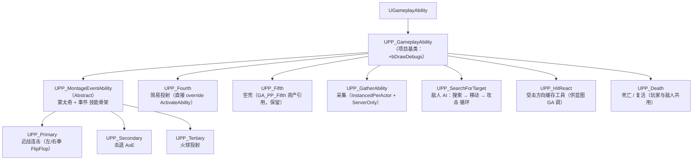
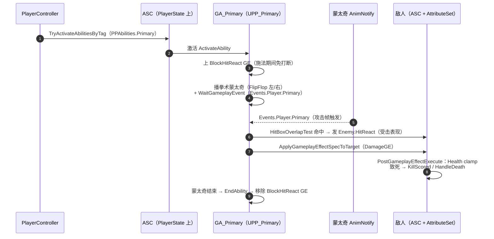

# GAS 技能体系专题文档

> 状态：背景资料 · 最后更新：2026-11-06 · 取代关系：无（GAS 专题参考，标签清单已不全）
> 本文是 [架构总览.md](../架构/架构总览.md) 的专题深入篇，聚焦 Gameplay Ability System 的完整实现细节。
> 阅读前建议先了解主文档 §2 的模块依赖与 §3 的 Core 基础设施。

---

## 1. 体系总览

### 1.1 类继承树



### 1.2 一次近战攻击的完整时序



---

## 2. 基础设施（Core 模块）

### 2.1 UPP_AttributeSet

[PP_AttributeSet.h](../../Source/PersonalProjectCore/Public/AbilitySystem/PP_AttributeSet.h) — 全项目唯一属性集，6 个属性全部 `DOREPLIFETIME_CONDITION_NOTIFY` 复制：

| 属性 | 说明 |
|---|---|
| Health / MaxHealth | 生命 |
| Mana / MaxMana | 法力 |
| Attack / Defense | 攻防（伤害公式输入） |

[PP_AttributeSet.cpp](../../Source/PersonalProjectCore/Private/AbilitySystem/PP_AttributeSet.cpp) 的 `PostGameplayEffectExecute`：

- `Health` clamp 到 `[0, MaxHealth]`，`Mana` clamp 到 `[0, MaxMana]`
- 生命归零时发送 `PPTags.Events.KillScored`（击杀计分事件，Payload 含击杀者）
- `bAttributesInitialized` 复制，初始化完成时广播通知（供 UI 等监听）

### 2.2 UPP_AbilitySystemComponent

[PP_AbilitySystemComponent.h](../../Source/PersonalProjectCore/Public/AbilitySystem/PP_AbilitySystemComponent.h) 在引擎 ASC 上增加：

- 技能等级包装：设置/增加指定技能的等级
- 冷却查询：按 GameplayTag 取冷却剩余/总时长（供 UI 技能槽 CD 显示）
- **`OnGiveAbility` 钩子**：被授予的技能若 asset tags 含 `PPTags.PPAbilities.ActivateOnGiven`，立即 `TryActivateAbility` —— 敌人 `SearchForTarget`、死亡技能这类「授予即启动」的技能靠它驱动

### 2.3 自定义 Task

- [PP_WaitGameplayEvent.h](../../Source/PersonalProject/Public/AbilitySystem/AbilityTasks/PP_WaitGameplayEvent.h)：继承 `UAbilityAsync_WaitGameplayEvent`，仅暴露蓝图 Async 代理入口（`WaitGameplayEventToActorProxy`），供蓝图侧用
- [PP_AttributeChangeTask.h](../../Source/PersonalProject/Public/AbilitySystem/Tasks/PP_AttributeChangeTask.h)：包装 `ASC->GetGameplayAttributeValueChangeDelegate(Attribute)`，回调签名 `(Attribute, NewValue, OldValue)`，用于属性条等监听

---

## 3. 角色 GAS 接线

### 3.1 ASC 的持有位置（重要不对称设计）

| 角色 | ASC 位置 | 原因 |
|---|---|---|
| 玩家（APP_PlayerCharacter） | **PlayerState 上**（APP_PlayerState 构造创建 ASC+AttributeSet） | 玩家死亡重生/换 Pawn 后属性与技能不丢失 |
| 敌人（APP_EnemyCharacter） | **自身** | 敌人随尸体销毁，无需跨 Pawn 保留 |

### 3.2 初始化时序（玩家双端）

[PP_PlayerCharacter.cpp](../../Source/PersonalProject/Private/Characters/PP_PlayerCharacter.cpp)：

- **服务器 `PossessedBy`**：`ASC->InitAbilityActorInfo(PlayerState, this)` → 广播 `OnASCInitialized` → `GiveStartupAbilities()`（遍历 `StartupAbilities` 逐个 `GiveAbility`）→ `InitializeAttributes()`（`InitializeAttributesEffect` GE ApplyToSelf）→ 注册 Health 变化回调（→ HandleDeath）
- **客户端 `OnRep_PlayerState`**：仅 `InitAbilityActorInfo` + 广播 + 注册回调，**不重复授予技能**（授予由服务器复制下来）

以上配置项（`StartupAbilities`、`InitializeAttributesEffect`、`ResetAttributesEffect`）声明在 Core 的 [PP_BaseCharacter.h](../../Source/PersonalProjectCore/Public/Characters/PP_BaseCharacter.h)，蓝图子类（BP_PP_PlayerCharacter / BP_PP_EnemyBase）按职业配置。

### 3.3 输入到激活

[PP_PlayerController.cpp](../../Source/PersonalProject/Private/Player/PP_PlayerController.cpp) `SetupInputComponent` 绑定 EnhancedInput 动作，五个技能输入分别映射：

```cpp
ActivateAbility(PPTags::PPAbilities::Primary);    // → ASC->TryActivateAbilitiesByTag
ActivateAbility(PPTags::PPAbilities::Secondary);  // 依此类推 Tertiary/Fourth/Fifth
```

技能能被激活的前提：蓝图 GA 资产的 **Ability Tags** 配了对应 tag（如 GA_PP_Primary 带 `PPTags.PPAbilities.Primary`）。

---

## 4. 核心骨架：UPP_MontageEventAbility

[PP_MontageEventAbility.cpp](../../Source/PersonalProject/Private/AbilitySystem/Abilities/PP_MontageEventAbility.cpp) 是玩家近战三连技的共同骨架（`InstancedPerActor`，因 AbilityTask 需 AddDynamic 绑定实例）。`ActivateAbility` 四步：

1. **上 BlockHitReact GE**：`MakeOutgoingSpec(BlockHitReactEffectClass, BlockHitReactLevel)` ApplyToSelf —— 施法期间免疫受击打断（`PPTags.PPAbilities.BlockHitReact`）
2. **缓存激活参数**（Handle/ActorInfo/ActivationInfo）供回调使用
3. **播蒙太奇**：`UAbilityTask_PlayMontageAndWait`，`Completed/BlendOut/Interrupted/Cancelled` **四个出口全部**绑定 `OnAbilityMontageFinished → EndAbility`（任何蒙太奇结局都收尾，杜绝能力悬挂）；`bStopMontageWhenAbilityEnds` 决定是否能力结束时强停蒙太奇
4. **等待技能事件**：`UAbilityTask_WaitGameplayEvent::WaitGameplayEvent(GetEventTagToWait(), OnlyTriggerOnce=false, OnlyMatchExact=true)` → 收到后转 `OnAbilityEventReceived(Payload)`

`EndAbility` 统一清理：`BP_RemoveGameplayEffectFromOwnerWithGrantedTags(BlockHitReact, 1)`。

**子类只需实现三个差异点**：

| 方法 | 职责 | 默认实现 |
|---|---|---|
| `GetMontageToPlay()` | 选蒙太奇 | 返回 `AbilityMontage` |
| `GetEventTagToWait()` | 等哪个事件 tag | — |
| `OnAbilityEventReceived(Payload)` | 事件触发时干什么 | 空 |

可调参数（protected）：`BlockHitReactEffectClass`、`BlockHitReactLevel`、`AbilityMontage`、`bStopMontageWhenAbilityEnds`。

---

## 5. 玩家技能详解

| 技能 | Tag | 等待的事件 | 事件触发行为 | 特殊点 |
|---|---|---|---|---|
| Primary 连击 | `PPAbilities.Primary` | `Events.Player.Primary`（蒙太奇 AnimNotify） | HitBox 球形检测 → 发敌人 HitReact → 逐目标 ApplyGE（等级=GetAbilityLevel） | `GetMontageToPlay` FlipFlop 左/右拳；`BlockHitReactLevel=0`、`bStopMontageWhenAbilityEnds=true` |
| Secondary 击退 | `PPAbilities.Secondary` | `PPAbilities.Secondary` | Commit → 粒子+镜头震动 → HitBox → `ApplyKnockback`（内外半径/推力/角度）→ `SendDamageEventToPlayers`（路径A） | AoE 控制型 |
| Tertiary 火球 | `PPAbilities.Tertiary` | `PPAbilities.Tertiary` | Commit → 前方生成 `APP_FireballProjectile`（Owner=Avatar） | 伤害在投掷物命中时结算（路径B） |
| Fourth | `PPAbilities.Fourth` | —（不用骨架） | Activate 里直接 Commit → 前方 100cm 生成 `APP_Projectile` → EndAbility | 极简即时技 |
| Fifth | `PPAbilities.Fifth` | — | 空实现 | **C++ 零引用但 GA_PP_Fifth 资产引用，禁止删除** |

[PP_Primary.cpp](../../Source/PersonalProject/Private/AbilitySystem/Abilities/Player/PP_Primary.cpp) 的命中三件套是近战技能的典型写法：

```cpp
TArray<AActor*> ActorsHit = UPP_BlueprintLibrary::HitBoxOverlapTest(...);  // ① 检测
SendHitReactEventToActors(ActorsHit);                                       // ② 表现（受击事件）
AbilitySystemComponent->ApplyGameplayEffectSpecToTarget(*Spec, TargetASC);  // ③ 结算
```

`HitBoxOverlapTest` 细节：以 `ActorLocation + Forward×偏移 + 高度偏移` 为球心做 `OverlapMultiByChannel`（ECC_Visibility，只对 Pawn Block），过滤出存活的 `APP_BaseCharacter`。

---

## 6. 采集技能：状态机式 Ability

[PP_GatherAbility.cpp](../../Source/PersonalProject/Private/AbilitySystem/Abilities/Gather/PP_GatherAbility.cpp)（`InstancedPerActor` + `ServerOnly`）：

- **Tag 驱动互斥**：`ActivationOwnedTags = State.Gathering`（激活期间自动持有），`BlockAbilitiesWithTag = State.Gathering`（采集时其他技能无法激活）。`State.Gathering` 在 `Config/DefaultGameplayTags.ini` 声明，C++ 侧 `RequestGameplayTag` 运行时获取
- **激活流程**：Commit → 通知采集物开始 → 播采集蒙太奇 → `RegisterGameplayTagEvent(State.Gathering, EGameplayTagEventType::NewOrRemoved)` 监听 → 启动采集计时器
- **三种结局**：
  - 计时完成 → `CompleteGather`（通知采集物结算，广播 `FPP_GatherEvent`）→ EndAbility
  - **Tag 被外部移除**（受击/移动打断）→ 监听回调 → `CancelAbility`
  - 松开按键 → 取消
- **EndAbility 清理**：停计时器、通知采集物取消、停蒙太奇、摘除 Tag 监听

## 7. 敌人 AI 技能组

敌人不用行为树，而是**用 GAS 技能驱动 AI 循环**（[PP_SearchForTarget.cpp](../../Source/PersonalProject/Private/AbilitySystem/Abilities/Enemy/PP_SearchForTarget.cpp)）：

```
SearchForTarget 激活（授予即启动，靠 ActivateOnGiven）
  → StartSearch：FindClosestActorWithTag 找最近玩家
  → 找到 → UAITask_MoveTo（AcceptanceRadius 内）
  → 成功 → RotateToTarget → WaitDelay(攻击前摇) → TryActivateAbilitiesByTag(PPAbilities.Enemy.Attack)
  → 敌人攻击 GA 激活（蓝图，蒙太奇上挂 UPP_MeleeAttack AnimNotifyState）
      → NotifyTick 每帧从武器 Socket 做 SphereTrace，命中存活玩家
      → SendGameplayEventToActor(自己, Events.Enemy.MeleeTraceHit) → 攻击 GA 内结算伤害
  → 攻击 GA 结束发 Events.Enemy.EndAttack → SearchForTarget 监听到 → 重新搜索
  （目标死亡 / 移动失败 / 自身死亡 → 回到 StartSearch）
```

- [PP_MeleeAttack.cpp](../../Source/PersonalProject/Private/Notifies/PP_MeleeAttack.cpp)：AnimNotifyState，Socket 球形 Sweep（Visibility 通道、只 Block Pawn），Payload 携带 HitResult 的 ContextHandle
- [PP_HitReact.h](../../Source/PersonalProject/Public/AbilitySystem/Abilities/Enemy/PP_HitReact.h)：纯工具类，`CacheHitDirectionVectors(Instigator)` 缓存 `AvatarForward`/`ToInstigator` 供蓝图按方向选受击蒙太奇；敌人受击由 `Events.Enemy.HitReact` 事件触发

## 8. 死亡与复活

[PP_Death.cpp](../../Source/PersonalProject/Private/AbilitySystem/Abilities/PP_Death.cpp)（GA_PP_Death，玩家敌人共用）：

1. 激活 → 播 `DeathMontage`（Completed/Interrupted/Cancelled 三绑定）+ 立即 ApplyToSelf `GE_Death`（授予 `PPTags.Status.Dead`）
2. 蒙太奇结束分流：
   - **敌人**：`bShouldRespawn` → Respawn，否则 `SetLifeSpan(1s)` + 隐藏尸体
   - **玩家**：直接 Respawn
3. `Respawn()`：移除 `Status.Dead` GE → 发 `Events.Enemy.EndAttack`（解锁 AI 循环）→ **仅服务器** `ResetAttributes()` + 传送 PlayerStart → `HandleRespawn()`（恢复碰撞/外观）→ EndAbility

**致死判定的两条路径**（易混淆点）：

- **路径A（SetByCaller 直伤，如 Secondary）**：`SendDamageEventToPlayer` 先读当前血量**预判致死** → 发 `Events.Player.Death`（玩家 GA_Death 监听此事件）或 `Events.Player.HitReact` → 再应用 GE（`AssignTagSetByCallerMagnitude(DataTag, -Damage)` 建在 **Target 自己 ASC** 上，并 `SetInstigator` 供击杀归属）
- **路径B（ExecCalc 公式伤，如火球）**：投掷物命中只发受击事件 + 应用 GE，**不预判死亡**；由目标侧 `OnHealthChanged → HandleDeath` 统一处理（伤害数值与死亡判定解耦）

## 9. 伤害结算核心：PP_DamageExecutionCalculation

[PP_DamageExecutionCalculation.cpp](../../Source/PersonalProject/Private/AbilitySystem/Executions/PP_DamageExecutionCalculation.cpp)：

```
最终伤害 = Max(Attack × Coefficient − Defense, MinimumDamage)
```

- **捕获**：`Attack` 取 **Source 快照**（Snapshot），`Defense` 取 **Target 实时**
- `Coefficient` 由 **SetByCaller** 传入（tag 如 `PPTags.SetByCaller.Player.Tertiary`），`MinimumDamage` 防免疫下限
- 输出：负向 Additive 写入 Target `Health`

> **关键陷阱**（[PP_BlueprintLibrary.cpp](../../Source/PersonalProject/Private/Utils/PP_BlueprintLibrary.cpp) 注释坐实）：ExecCalc 路径的 Spec 必须建在**施法者** ASC 上（`CauserASC->MakeEffectContext()`），否则 Source 攻击力会读到受击者自己；而路径A直伤相反，建在 Target ASC 上。写新伤害代码时先想清楚走哪条路。

---

## 10. GameplayTag 全清单

C++ 原生 tag（[PPTags.cpp](../../Source/PersonalProjectCore/Private/GameplayTags/PPTags.cpp)，声明带 `PERSONALPROJECTCORE_API` 导出宏）：

| 命名空间 | Tag |
|---|---|
| — | `PPTags.None` |
| SetByCaller | `Projectile`、`Player.Secondary`、`Player.Tertiary`（伤害/系数载体） |
| PPAbilities | `ActivateOnGiven`（授予即激活）、`Primary/Secondary/Tertiary/Fourth/Fifth`、`BlockHitReact`（免打断）、`Enemy.Attack` |
| Events | `KillScored`；`Player.HitReact/Death/Primary`；`Enemy.HitReact/EndAttack/MeleeTraceHit`；`UI.ShowScoreboard/TogglePause/DamageNumber` |
| Status | `Dead`（GE_Death 授予） |

ini 声明的 tag（`Config/DefaultGameplayTags.ini`）：`State.Gathering`（采集状态，被攻击移除以打断）。

---

## 11. 扩展指南：新增一个技能

以新增「蒙太奇+事件」型技能为例：

1. **C++**：继承 `UPP_MontageEventAbility`，实现三个差异点方法；如需新 tag，在 [PPTags.h](../../Source/PersonalProjectCore/Public/GameplayTags/PPTags.h) 按命名空间追加（类带导出宏，无需重定向）
2. **蓝图资产**：新建 GA 蓝图选该 C++ 类为父类 → 配置 Ability Tags（激活用）、`AbilityMontage`、`BlockHitReactEffectClass`（GE_BlockHitReact）、Cooldown/Cost GE
3. **蒙太奇**：在攻击帧加 AnimNotify 发出对应 `Events.*` GameplayEvent（或用 `PP_MeleeAttack` 做持续判定）
4. **伤害 GE**：选结算路径——固定直伤走路径A（SetByCaller + SendDamageEventToPlayer），公式伤走路径B（GE 配 `PP_DamageExecutionCalculation`，SetByCaller 系数）
5. **授予**：把 GA 加进角色蓝图的 `StartupAbilities`；玩家主动技能在 PC 输入绑定时已预留 Fourth/Fifth 位
6. **调试**：`bDrawDebugs` 打开 HitBox/Trace 调试绘制

---

## 12. 源码索引

| 主题 | 文件 |
|---|---|
| 骨架 | [PP_MontageEventAbility.cpp](../../Source/PersonalProject/Private/AbilitySystem/Abilities/PP_MontageEventAbility.cpp) |
| 玩家技能 | [Player/ 目录](../../Source/PersonalProject/Private/AbilitySystem/Abilities/Player)（Primary/Secondary/Tertiary/Fourth） |
| 采集 | [PP_GatherAbility.cpp](../../Source/PersonalProject/Private/AbilitySystem/Abilities/Gather/PP_GatherAbility.cpp) |
| 敌人 AI | [PP_SearchForTarget.cpp](../../Source/PersonalProject/Private/AbilitySystem/Abilities/Enemy/PP_SearchForTarget.cpp) · [PP_MeleeAttack.cpp](../../Source/PersonalProject/Private/Notifies/PP_MeleeAttack.cpp) |
| 死亡 | [PP_Death.cpp](../../Source/PersonalProject/Private/AbilitySystem/Abilities/PP_Death.cpp) |
| 伤害 | [PP_DamageExecutionCalculation.cpp](../../Source/PersonalProject/Private/AbilitySystem/Executions/PP_DamageExecutionCalculation.cpp) · [PP_BlueprintLibrary.cpp](../../Source/PersonalProject/Private/Utils/PP_BlueprintLibrary.cpp) |
| 属性/ASC | [PP_AttributeSet.cpp](../../Source/PersonalProjectCore/Private/AbilitySystem/PP_AttributeSet.cpp) · [PP_AbilitySystemComponent.cpp](../../Source/PersonalProjectCore/Private/AbilitySystem/PP_AbilitySystemComponent.cpp) |
| 接线 | [PP_PlayerCharacter.cpp](../../Source/PersonalProject/Private/Characters/PP_PlayerCharacter.cpp) · [PP_PlayerState.cpp](../../Source/PersonalProject/Private/Player/PP_PlayerState.cpp) |
| Tags | [PPTags.cpp](../../Source/PersonalProjectCore/Private/GameplayTags/PPTags.cpp) |
