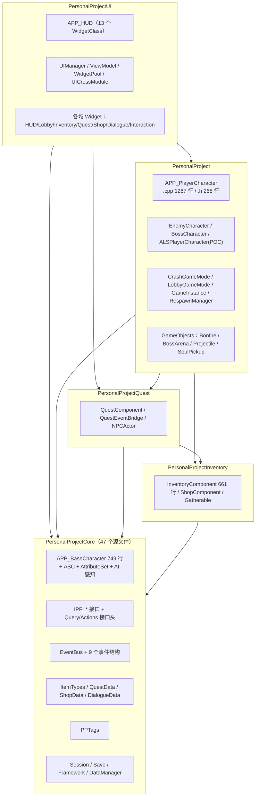
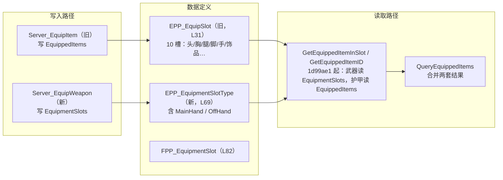
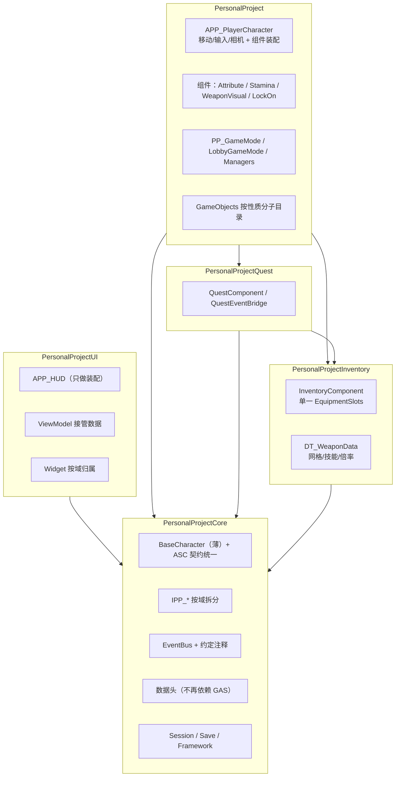

# 重构前后架构对比

> 状态：现行（架构判断依据）
> 最后更新：2026-11-07
> 代码基线：`f5c01db`（另有 7 个未推送提交，均为 P3 类小改）
> 用途：判断这次重构值不值、还差什么。**不作为开工排期依据**，排期看 `docs/计划/当前主线任务书.md`（仅本地）。

---

## 0. 阅读约定

### 0.1 标注法

| 标注 | 含义 |
|---|---|
| **已落地 `<commit>`** | 代码中可验证，附提交号 |
| **计划中 P4 / P5 / P6** | 任务书里的目标形态，**代码尚未实现** |
| **待确认** | 静态阅读无法定性，需要开编辑器或运行验证 |

### 0.2 事实基线

- 分支 `poc/als-integration`，HEAD `f5c01db`，本地领先远端 7 个提交（P3 清理）。
- 已落地的重构相关改动：P1 收口（`52a9e05`…`af1b828`）、装备读取路径统一（`1d99ae1`）、P3 低风险清理（`6548a2e`、`7f7e6a1`、`d7b2bb4`、`1f8c61a`、`740d96e`、`d195092`、`d29c847`、`f6cd7dd`、`f5c01db`）。
- **P2（冒烟清单与基线数字）未落地**：仓库里没有受控的冒烟清单文件，编译耗时/帧时间/Warning 数没有任何记录。这直接影响"收益可量化"的可信度，后文凡涉及性能的数字都标 **估算**。
- P4/P5/P6 全部未开工，P6 在当前任务书中明确"不排期"。

### 0.3 一句话结论（先给判断）

这次重构到目前为止做的是**边界清淤**（死代码、重复事件、头文件污染、装备读取双轨），风险低、收益确定但偏局部；真正改变结构的 P4（拆组件、装备写路径统一）和 P5（配置数据化）还没开始。**现在还不是判断"值不值"的时点**，可判断的是"方向对不对、代价是否可控"——这两点目前都成立。

---

## 1. 现状架构

### 1.1 分层与依赖（当前真实状态）

**依赖方向**：`UI → PersonalProject → Quest → Inventory → Core`，单向无环，**已落地**（各 `*.Build.cs` 可直接核对）。

- `PersonalProject` 不 include 任何 UI 头：0 处（grep 验证）。
- `Quest` 不 include `PersonalProject` 的实现类：0 处。
- `UI` 的 Build.cs 依赖 `Core / Quest / PersonalProject`，`d29c847` 已移除对 Inventory 的依赖；代码中只剩 **1 处**引用实现类——`PP_HUD.cpp:34` 的 `Characters/PP_PlayerCharacter.h`（用于读玩家属性）。

结论：**模块方向是健康的**，问题不在这条主线上，而在每个模块内部怎么组织。

### 1.2 各模块职责（当前）

| 模块 | 当前实际承担的职责 | 问题 |
|---|---|---|
| **Core（47 文件）** | 角色基类（749 行，含 ALS 继承、死亡、受击、ASC 转发、标签门控）、ASC/AttributeSet、AI 感知、GameplayTags、5 类数据头、11 个接口、EventBus、DataManager、SessionManager、LocalSaveGame、Log | 仍是"基础设施 + 玩法基座 + 服务 + 表现补丁"四合一；`Framework/` 已在 `e941461` 拆出 `Events/`、`Session/`、`Save/`、`Query/`，但职责边界没变 |
| **PersonalProject** | 玩家/敌人/Boss 角色、GAS 能力与 Execution、GameMode 族、GameObjects、PlayerController/PlayerState/UIGateway、Notify/Utils/Editor 工具 | `APP_PlayerCharacter` 1267 行，承担移动、相机、输入、装备外观、GA 授予、死亡、调试命令；`PP_CrashGameMode` 名字仍是课程模板 |
| **Inventory** | 背包/装备/商店/采集，10 个旧装备槽 + 2 个武器槽，GE 属性加成 | 装备存在**两套枚举、两条写入路径**（见 1.4） |
| **Quest** | 任务组件、任务事件桥、NPC 对话 | 3 个 `BindTo*` 桩函数已删（`a606672`），`SendChat` 硬编码已修（`c687279`） |
| **UI** | HUD、13 个 WidgetClass 调度、UIManager/ViewModel/WidgetPool、8 个杂项 Widget | 仍在 `APP_HUD` 集中创建界面，ViewModel 机制未真正接管 |

### 1.3 角色类现状

| 类 | 规模 | 已落地变化 | 遗留 |
|---|---|---|---|
| `APP_BaseCharacter`（Core） | 749 行 | 统一 `CanBeDamaged` 的 `Status.Invulnerable/Dead/BossPhaseTransition` 判定；`GetAbilitySystemComponent()` 声明为 override | **直接返回 `nullptr`**（`PP_BaseCharacter.cpp`）。玩家在 PlayerState、敌人在自身，子类必须各自 override；漏 override 时"能移动但没技能"，且无敌帧判定静默失效 |
| `APP_PlayerCharacter` | .cpp 1267 / .h 268 | 闪避无敌帧由 ALS 翻滚状态驱动（`1a7a9fd`）；背包武器走新槽位 API（`af1b828`）；装备变更广播（`1d99ae1`） | 仍是 God Class：移动/相机/输入/外观/GA/死亡/调试命令全在一类；`WeaponMeshMap`（`TMap<FName,FPP_WeaponMeshVisual>`）硬编码在类上（`PP_PlayerCharacter.h:343`） |
| `APP_EnemyCharacter` / `APP_BossCharacter` | — | Boss 场地触发器补了空引用告警与归属校验（`104bf43`） | Boss 门按 `BossName` 匹配，多 Boss 场景依赖关卡配置正确 |
| `APP_ALSPlayerCharacter` | — | 外部引用 **0 处**（`6548a2e` 清死代码时未删） | 文件仍在，属 POC 孤岛；**待确认**是否有蓝图子类依赖，删除前需查资产 |
| 组件化程度 | — | 仅有 `AbilitySystem`、`AIPerception`、`Inventory`、`Shop`、`Quest`、`Widget` 六个组件 | **没有**属性/耐力/武器外观/锁定组件——P4.1 的目标形态尚未开始 |

### 1.4 装备数据现状（最容易误判的一块）

- **读取已统一**（`1d99ae1`）：武器两槽以 `EquipmentSlots` 为唯一事实源，护甲/饰品仍走 `EquippedItems`；服务端装备/卸下后主动广播事件，修掉了单机/主机 UI 不刷新。
- **写入仍是双轨**：UI 装备按钮走旧轨 `RequestEquipItem` → `Server_EquipItem`；`Server_EquipWeapon` 的调用者是背包右键（`af1b828` 接的）。同一次"装备武器"可能走两条路径，**P4.2 未做**。
- `FPP_WeaponData` 的 `AbilityTags`（`PP_ItemTypes.h:117`）与 `DamageMultiplier`（L121）**仍无消费方**（P1.6 待决策）。
- 武器外观：`WeaponMeshMap` 在角色类上（而非数据表），新增武器必须改 C++ 默认值或蓝图实例。

### 1.5 已知跨模块耦合点

| 耦合点 | 现状 | 性质 |
|---|---|---|
| 玩家 ASC 位置 | 玩家在 `PlayerState`，敌人在角色自身；基类 getter 返回 `nullptr` | **契约不一致**，新角色必踩 |
| `IPP_UIGateway` | 一个接口承担 HUD 全部数据请求（属性、Buff、任务、商店、结算…） | 接口膨胀，UI 与玩法协议绑死 |
| `APP_HUD` | 13 个 `TSubclassOf` WidgetClass 集中调度 + 每帧扫 Boss | 每加界面改 HUD；帧开销未量化（**待确认**，无基线） |
| EventBus | 9 个事件结构，跨系统通知全走它；GameplayTag 与 EventBus 并存 | 分工无文档约定，易长平行系统 |
| 数据契约 | `FName` 手工约定（ItemID、CharacterId、BossName、Quest TargetID） | 拼错不报错，运行期静默失效 |
| Core 的 `Framework/` | 已拆出 `Events/Session/Save/Query` | 目录已清，职责未清；`Core` 仍同时是 Infra 与 GameplayCore |

### 1.6 编译期边界（P3 已落地的部分）

| 改动 | Commit | 效果 |
|---|---|---|
| `IPP_EquipmentUser` 拆独立头 | `d195092` | 不再被 `PP_ItemTypes.h` 连带拉入 |
| `EPP_UILayer` 移入轻量头 | `740d96e` | UI 枚举不再牵连实现头 |
| `PP_SessionManager.h` 前向声明 `IOnlineSessionPtr` | `1f8c61a` | 头文件不再暴露 OnlineSubsystem |
| `PP_PlayerController.h` 前向声明 `UUserWidget` | `d7b2bb4` | 去掉 UMG 头传染 |
| `PP_ItemTypes.h` 前向声明 `UGameplayAbility` | `f6cd7dd` | 数据头不再拉 GAS |
| UI 去掉 Inventory 依赖 | `d29c847` | 模块依赖图少一条边 |

这些是"编译期边界"层面的真实收益，但**没有编译时间基线**，无法给出秒数（P2 缺失）。

---

## 2. 目标架构（P4–P6 全部落地后）

> 本节全部为**计划中**，代码未实现。P6 在任务书中标注"不排期"，此处仅画出形态供对比。

### 2.1 目标分层

目标态与现状的图差只有三处：**UI 不再直接依赖 PersonalProject**（数据经 Gateway/ViewModel）、**装备只剩一条写入路径**、**角色多四个组件**。模块数量与依赖方向不变。

### 2.2 目标模块职责（P4–P6）

| 阶段 | 目标 | 具体范围 |
|---|---|---|
| **P4.1** | 玩家角色拆组件：属性 → 耐力 → 武器外观 → 锁定 | 顺序不可颠倒；锁定最后，因为它依赖前三个的 Tick 时序 |
| **P4.2** | 装备槽统一（Branch by Abstraction 四步） | 保留旧 API 外壳 → 新 API 成为唯一实现 → 迁移调用方 → 删旧枚举 |
| **P5** | 配置数据化 | 武器网格进 `DT_WeaponData`；角色能力进数据表；Lobby 改 `TSubclassOf`；删除按职业硬编码的兜底 |
| **P6** | Core 拆 Infra / GameplayCore、联机事件策略、GameFlow 状态机、存档契约 | **不排期**，只在真正需要时启动 |

### 2.3 目标角色与装备

- `APP_PlayerCharacter` 目标只保留：移动/相机/输入转发、组件装配、死亡流程编排；**估算**降到 400–600 行（无实测）。
- 属性/耐力/武器外观/锁定各自独立组件，可单独测试；锁定组件不再与输入处理耦合。
- 装备只有一个枚举 `EPP_EquipmentSlotType`、一个 `TMap<EPP_EquipmentSlotType, FPP_EquipmentSlot>`，武器与护甲同构；旧 `EPP_EquipSlot` 与 `EquippedItems` 删除。
- 武器视觉、技能、伤害倍率全部来自 `DT_WeaponData`，新增武器零 C++ 改动。

### 2.4 目标边界

- 跨模块只经 Core 的 `IPP_*` 与 EventBus；`APP_HUD` 不再直接 include `PP_PlayerCharacter.h`（当前唯一一处实现类引用）。
- 事件分工写进 `PP_EventTypes.h` 注释：GAS/动画/AI 门控用 GameplayTag，跨系统通知用 EventBus。
- 新增角色只实现 ASC 契约与数据行，不继承 `APP_PlayerCharacter`。

---

## 3. 逐项对比与优化收益

| # | 优化点 | 现状 | 目标 | 改了什么 | 好处 | 代价 / 风险 |
|---|---|---|---|---|---|---|
| 1 | **模块依赖** | 5 模块单向无环；UI 依赖 Core/Quest/PersonalProject，1 处 include 实现类 | 同方向，但 UI 只依赖接口，零实现类引用 | P5 收尾 + HUD 改 ViewModel | 新增界面不触发下层重编译；UI 可脱离玩法模块单测（**待确认**当前是否可单测） | 需要一层 DTO/ViewModel，前期开发变慢约 20–30%（**估算**） |
| 2 | **Core 职责** | 47 文件，Infra 与玩法基座混在一起 | P6 拆 Infra/GameplayCore（不排期） | 目录与 Build.cs 拆分 | 编译隔离：改 Session 不重编角色（**估算**可省 10–15% 增量编译） | 模块数 5→6，蓝图/CoreRedirects 风险；P6 未排期，短期**无收益** |
| 3 | **角色 God Class** | `PlayerCharacter.cpp` 1267 行，7 类职责 | 4 个组件 + 编排，**估算** 400–600 行 | P4.1 顺序拆：属性→耐力→武器外观→锁定 | 单点修改面变小；耐力/锁定可独立验证；`WeaponMeshMap` 移出角色 | 组件间 Tick 顺序与初始化时序易错；蓝图属性迁移会静默丢失，必须逐项核对 |
| 4 | **装备双轨** | 读已统一（`1d99ae1`），写仍两套枚举、两条 RPC | 单枚举、单写入、单存储 | P4.2 Branch by Abstraction 四步 | 消除"UI 装备不走新 API"一类问题；护甲/武器同构，新增槽位零分支 | 涉及蓝图与存档字段迁移；旧存档兼容需**待确认**（无存档系统，风险低） |
| 5 | **配置硬编码** | `WeaponMeshMap` 在角色类、`CharacterAbilityMap` 在 GameMode、13 个 WidgetClass 在 HUD | 全部进数据表/资产 | P5 | 新增武器/角色/界面零 C++ 改动；策划可自服务 | 数据表校验缺失时错误后移；需补启动期校验 |
| 6 | **事件体系** | EventBus 9 结构 + GameplayTag 并存，分工无约定 | 分工写入注释，死 Tag 清零 | `52a9e05` 已删死 Tag；`f5c01db` 合并重复事件 | 现存量已减少；`BossDead` 与 `SettlementShow` 合并后少一处双写 | 约定靠人遵守；后续仍需评审，否则会长新平行系统 |
| 7 | **编译期边界** | 6 处头文件污染已清（`d195092` 等） | 数据头不依赖 GAS/UMG/Online | P3 已落地 | 头文件传染减少，改 UI 不重编数据层 | 收益无基线（P2 缺失），只能定性 |
| 8 | **UI 结构** | 13 个 WidgetClass 集中 HUD，8 个杂项 Widget | HUD 只装配，Widget 按域归属 | P5 收尾（P3 只做了类型前移） | 每加界面的改动点从 HUD 移到对应域 | ViewModel 迁移工作量大，且无自动化验证 |
| 9 | **死代码/死事件** | POC 角色、零引用类、5 处死 Tag、3 个桩函数 | 全部清除 | `6548a2e`、`a606672`、`52a9e05` | 认知负担下降；`ALSPlayerCharacter` 仍**待确认**是否可删 | 删除前需查蓝图引用，误删只能靠版本回滚 |
| 10 | **性能** | 无基线；HUD 每帧扫 Boss、锁定/感知 Tick、近战每帧球扫 | 锁敌改为事件驱动、HUD 去每帧扫描 | **未纳入本次重构**（见 §4） | 未知，需先补 P2 基线 | 无基线时任何"优化"都无法验收，容易做成感觉工程 |

### 3.1 收益可信度说明

- 有 commit 可验证的：#4 的读取部分、#6、#7、#9。
- 属结构收益、无法量化的：#1、#2、#8、#10。
- **唯一可量化但当前无数据的是编译时间与帧时间**，因为 P2 未落地。若要用这份文档做"值不值"的最终判断，建议先补两个数字：全量编译耗时、主城场景平均帧时间。

---

## 4. 还能继续优化的部分（本次重构范围外）

### 4.1 值得做

| 项 | 理由 |
|---|---|
| **P2 冒烟清单 + 三个基线数字** | 没有它，P4/P5 的收益无法验收，回归也无法归因 |
| **ASC 契约统一** | 基类 getter 返回 `nullptr` 是所有新角色的第一个坑，改动小、收益直接 |
| **锁敌与 HUD 的每帧扫描改事件驱动** | 明确的热点，且不依赖大重构，可独立验收 |
| **`ALSPlayerCharacter` POC 清理** | 外部零引用，留着只会误导新人；删前查蓝图子类 |
| **启动期数据校验** | `FName` 手工契约（ItemID/BossName/TargetID）拼错不报错，校验器可把静默失败变成启动告警 |

### 4.2 只在大改时才值得

| 项 | 理由 |
|---|---|
| **Core 拆 Infra / GameplayCore（P6）** | 收益是编译隔离，成本是模块数、CoreRedirects 与全员认知；5 模块规模下收益不足以覆盖成本 |
| **UI 全面 ViewModel 化** | 13 个界面的迁移量大于收益，除非 UI 需求进入高频迭代期 |
| **联机会话抽象替换（EOS/Nakama）** | 当前联机形态未定，抽象层会锁死错误方向 |
| **存档系统（含云存档）** | 需求与字段未定，先做契约再谈实现 |

### 4.3 明确不做

| 项 | 理由 |
|---|---|
| 引入第三方战斗框架（GCS/ACF/ACS 等） | 与现有 GAS 层双轨，技术债大于收益 |
| 新增模块（第 6、第 7 个） | 5 模块边界已够用，模块数增加的是沟通成本 |
| 把 EventBus 换成 GameplayMessageSubsystem | 现有 9 个事件规模下收益为零，迁移只会制造风险 |
| 全量资产目录重构 | 按《Content资产整理方案》分批做即可，不需要一次大搬迁 |
| ALS 插件内部改造 | 第三方插件，改内部等于放弃升级路径；需要隔离时在 `APP_BaseCharacter` 侧做适配 |

---

## 5. 判断"值不值"的三条依据

1. **已花掉的部分**：P1 收口 + P3 清理，均为低风险、可独立回滚的改动，没有引入新概念，**沉没成本很低**。
2. **决定成败的部分**：P4.1 拆组件与 P4.2 装备写路径统一。它们动的是角色类与蓝图/资产，风险集中在这里；如果只做一半（例如拆了组件但装备仍双轨），收益会被抵消。
3. **还差的部分**：P2 的验收基础设施。没有冒烟清单和基线，P4/P5 完成后无法证明"变好了"，只能证明"没崩"。**这是当前最该补的一件事，且成本最低。**

---

## 变更记录

| 日期 | 变更 |
|---|---|
| 2026-11-07 | 初版：基于 `f5c01db`；区分已落地/计划中；标注 P2 缺失导致的量化缺口 |
