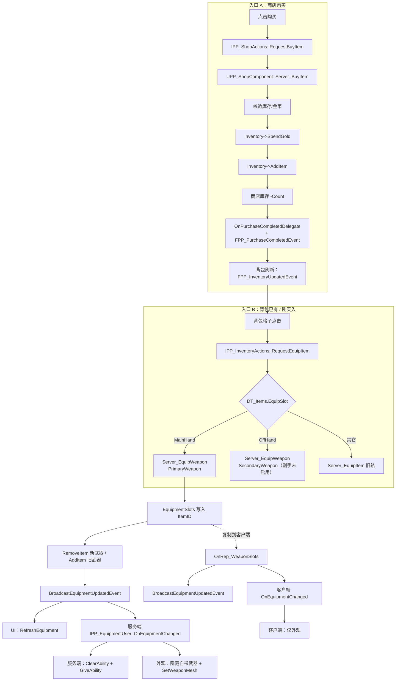

# 武器装备体系流程梳理（单武器槽）

> 范围：武器「已装备」后的完整链路——背包/商店 → 装备槽 → 手上模型 → 技能 → 属性 → 各面板显示。
> 口径：**只保留主手一个武器槽，不做副手**；`OffHand` 枚举与资源保留，运行时不启用。
> 基于当前 `HEAD`（含 `af1b828` 装备路由、`1d99ae1` 装备槽查询修复）。本文只梳理，不改代码。

---

## 1. 结论摘要

| 环节 | 现状 | 结论 |
|---|---|---|
| 背包装备路由 | 武器经 `RequestEquipItem` → `Server_EquipWeapon` 写入新轨 | 通 |
| 装备面板显示 | `QueryEquippedItems` 已合并新旧两轨；服务端/客户端均会广播 `FPP_EquipmentUpdatedEvent` | 通（1d99ae1 修复） |
| 手上模型 | `OnEquipmentChanged` 对 `PrimaryWeapon` 生效；客户端依赖 `OnRep_WeaponSlots` | 通，但**重生/晚加入不恢复** |
| 技能切换 | 服务端按 `DT_WeaponData.WeaponAbilityClass` 授予/移除 GA | 通，但**重生/晚加入不恢复**，且存在重复授予风险 |
| 属性加成 | 新轨**完全不处理** `EquipEffectClass` | **断** |
| 商店侧「已装备」 | 商店只认背包物品与金币，没有任何装备状态 | 无标记，需产品口径确认 |
| 副手 | 代码仍保留 `OffHand → SecondaryWeapon` 路由与外观空白 | 建议收敛为不启用 |

三处最需要先认识的问题：

1. **属性断点**：旧轨 `ApplyEquip` 会施加 `EquipEffectClass`，新轨 `Server_EquipWeapon` 只切 GA，不施加任何 GE。
2. **初始状态断点**：新 Pawn 的 `BeginPlay` 不读 `EquipmentSlots`，动态授予的武器 GA 随旧 Pawn 的 ASC 消失；晚加入客户端若 `OnRep_WeaponSlots` 早于 Pawn 生成，外观也不会补。
3. **旧入口幽灵状态**：任何蓝图直接调 `Server_EquipItem` 装武器，会写进旧轨 `EquippedItems` 并施加 GE，但新轨查询已过滤旧轨武器项 → 面板看不到，背包里也没了。

---

## 2. 数据模型：两套并行的装备轨

| | 旧轨 | 新轨 |
|---|---|---|
| 存储 | `UPP_InventoryComponent::EquippedItems`（`TArray<FPP_EquippedItem>`） | `UPP_InventoryComponent::EquipmentSlots`（`TArray<FPP_EquipmentSlot>`，固定 4 槽） |
| 槽位枚举 | `EPP_EquipSlot`（MainHand / OffHand / 防具 / Ring） | `EPP_EquipmentSlotType`（PrimaryWeapon / SecondaryWeapon / Helmet / Accessory） |
| 每项内容 | `ItemID` + `Slot` + `EffectHandle`（GE 句柄） | `SlotType` + `ItemID`（无 GE 句柄） |
| 复制 | `ReplicatedUsing = OnRep_Equipped` | `ReplicatedUsing = OnRep_WeaponSlots` |
| 写入函数 | `Server_EquipItem` → `ApplyEquip` / `Server_UnequipItem` → `ApplyUnequip` | `Server_EquipWeapon` / `Server_UnequipWeapon` |
| 读取函数 | `QueryEquippedItems`（仅非武器槽）、`QueryEquippedItemInSlot`（非武器槽） | `QueryEquippedItems`（合成武器项）、`QueryEquippedItemInSlot(MainHand/OffHand)`、`GetWeaponInSlot` |
| 属性 | 施加并记录 `EquipEffectClass` 的 GE | 无 |
| 技能 | 无 | `IPP_EquipmentUser::OnEquipmentChanged` → GA 授予/移除 |

关键合成规则（`1d99ae1` 起，`PP_InventoryComponent.cpp` 的 `QueryEquippedItems_Implementation`）：

```
QueryEquippedItems()
  = EquippedItems 中 Slot 不是 MainHand/OffHand 的项
  + EquipmentSlots 中非空武器槽（PrimaryWeapon → MainHand，SecondaryWeapon → OffHand）
```

`GetEquippedItemInSlot(MainHand/OffHand)` 与 `GetEquippedItemID` 也已改读新轨。

---

## 3. 端到端数据流

### 3.1 总览



### 3.2 入口 A：商店购买

| 步骤 | 谁写入 | 数据落点 | 函数 / 事件 |
|---|---|---|---|
| 1 | UI | — | `UPP_ShopItemWidget` 打开数量浮窗 → `IPP_ShopActions::Execute_RequestBuyItem` |
| 2 | 商店组件（服务端） | — | `UPP_ShopComponent::Server_BuyItem`：商品存在、库存、金币三项校验 |
| 3 | 库存组件 | `Gold` 减少 | `UPP_InventoryComponent::SpendGold` → `BroadcastGoldUpdatedEvent` |
| 4 | 库存组件 | `Items` 增加 | `AddItem` → `BroadcastInventoryUpdatedEvent` |
| 5 | 商店组件 | 商店 `Stock` 减少 | `Server_BuyItem` 内 |
| 6 | 商店组件 | — | `OnPurchaseCompletedDelegate`（任务系统）+ `FPP_PurchaseCompletedEvent`（UI） |
| 7 | 客户端 | — | `OnRep_Gold` / `OnRep_Items` → 各 UI 刷新 |

商店购买**只负责把武器放进背包**，不装备、不读任何装备轨。"已买入" 与 "已装备" 在商店侧没有任何视觉区分。

### 3.3 入口 B：背包内已有武器 → 装备

| 步骤 | 谁写入 | 数据落点 | 函数 / 事件 |
|---|---|---|---|
| 1 | UI | — | `UPP_ItemSlotWidget::HandleSlotClicked` → `Execute_RequestEquipItem(ItemID)` |
| 2 | 库存组件（客户端） | — | `RequestEquipItem_Implementation`：`DT_Items.EquipSlot` 决定路由 |
| 3 | 库存组件（服务端） | `EquipmentSlots[i].ItemID` | `Server_EquipWeapon(ItemID, PrimaryWeapon)` |
| 4 | 库存组件 | `Items` 减少 / 旧武器回包 | `RemoveItem(新)` → `AddItem(旧)`（满包则回滚并取消） |
| 5 | 库存组件 | — | `BroadcastEquipmentUpdatedEvent`（服务端主动广播） |
| 6 | UI | — | `UPP_InventoryWidget::HandleEquipmentUpdated` → `RefreshEquipment` → 逐槽 `RefreshOneEquipSlot` |
| 7 | 角色（服务端） | ASC AbilitySpec | `IPP_EquipmentUser::Execute_OnEquipmentChanged` → `ClearAbility(旧)` + `GiveAbility(DT_WeaponData.WeaponAbilityClass)` |
| 8 | 角色（双端） | 武器网格 | `SetBuiltInWeaponVisible(false)` + `SetWeaponMesh(ItemID)` |
| 9 | 复制 | — | `EquipmentSlots` 复制 → 客户端 `OnRep_WeaponSlots` → 广播事件 + `OnEquipmentChanged`（仅外观生效） |

补充：`RemoveItem` / `AddItem` 本身也会广播 `FPP_InventoryUpdatedEvent`，所以背包列表会同步把该武器格子移除/恢复；装备栏由 `FPP_EquipmentUpdatedEvent` 单独驱动。

### 3.4 卸下

| 步骤 | 谁写入 | 数据落点 | 函数 / 事件 |
|---|---|---|---|
| 1 | UI | — | `UPP_EquipSlotWidget::HandleSlotClicked` → `Execute_RequestUnequipItem(MainHand)` |
| 2 | 库存组件（服务端） | `EquipmentSlots[i].ItemID = NAME_None` | `Server_UnequipWeapon`（背包满则取消） |
| 3 | 库存组件 | `Items` 增加 | `AddItem(旧武器)` |
| 4 | 库存组件 | — | `BroadcastEquipmentUpdatedEvent` |
| 5 | 角色（服务端） | ASC | `OnEquipmentChanged(Slot, NAME_None)` → `ClearAbility` |
| 6 | 角色（双端） | 武器网格 | `ClearWeaponMesh()` + `SetBuiltInWeaponVisible(true)` |

### 3.5 四个终点的实际读取者

| 终点 | 数据源 | 读取者 | 触发时机 |
|---|---|---|---|
| 装备面板槽位 | `QueryEquippedItems`（合并轨）/ `QueryEquippedItemInSlot` | `UPP_InventoryWidget::RefreshOneEquipSlot` | `BindInventory`、`FPP_EquipmentUpdatedEvent` |
| 物品提示框对比 | `QueryEquippedItemInSlot(HoveredInfo.EquipSlot)` | `UPP_ItemTooltipWidget::BuildComparison` | 悬停时 |
| 手上模型 | `WeaponMeshMap[ItemID]`（蓝图配置） | `APP_PlayerCharacter::SetWeaponMesh` | `OnEquipmentChanged`（服务端 + 客户端 OnRep） |
| 技能 | `DT_WeaponData[ItemID].WeaponAbilityClass` | `APP_PlayerCharacter::OnEquipmentChanged_Implementation` | 仅服务端；按键由 `PPAbilities::Primary` 等 GameplayTag 匹配激活 |
| 属性 | `DT_Items[ItemID].EquipEffectClass` | 旧轨 `ApplyEquip` 施加 GE | **新轨不读取** |

---

## 4. 两端现在各自认哪套数据

| 侧 | 认什么 | 是否感知武器装备状态 |
|---|---|---|
| 背包（背包页签） | 物品列表 `Items`；装备栏 `QueryEquippedItems`（合并轨） | 是：装备后武器从 `Items` 移除，装备槽显示 |
| 背包（提示框对比） | `QueryEquippedItemInSlot`（武器槽读新轨） | 是 |
| 商店（购买页签） | `Items` 数量、`Gold`、商店 `Stock` | **否**：没有"已装备"标记，也无法识别该物品正被装备 |
| 商店（出售页签） | `Items` 数量 | 间接：已装备武器已离开 `Items`，因此不会出现在可出售列表 |
| 角色（模型） | `EquipmentSlots` 变化事件 | 是（但仅变更瞬间，不读初始状态） |
| 角色（技能） | `DT_WeaponData` + `EquipmentSlots` 变化回调 | 是（仅变更瞬间，不读初始状态） |

结论：**背包侧已经统一到合并轨，商店侧本来就不参与装备状态**。当前没有"商店显示已装备"这一功能，若产品要求，需要新增读取 `QueryEquippedItems` 的展示逻辑，而不是修数据。

---

## 5. 断点与不一致点

| 编号 | 断点 | 位置 | 影响 | 严重度 |
|---|---|---|---|---|
| B1 | 新轨不施加武器属性 GE | `Server_EquipWeapon`（无 `EquipEffectClass` 处理） | 武器数值加成完全不生效；旧轨路径才生效 | P0（若武器配置了属性） |
| B2 | 重生 / 晚加入不恢复装备表现 | `APP_PlayerCharacter::BeginPlay` 未读 `EquipmentSlots`；`OnRep_WeaponSlots` 在 Pawn 未就绪时直接 return | 死亡复活后、晚加入客户端、重连后：手上无武器、武器技能丢失（服务端复活会重新 PossessedBy，但该路径只给 StartupAbilities） | P0 |
| B3 | 旧入口装武器产生幽灵状态 | `Server_EquipItem` 对 MainHand/OffHand 仍走旧轨 | 若蓝图直接调用：物品从背包消失、GE 生效、但面板与新轨都查不到；只能通过旧轨卸下 | P1 |
| B4 | 副手路由未收敛 | `RequestEquipItem` 的 `OffHand → SecondaryWeapon` 分支；`OnEquipmentChanged` 外观仅处理 `PrimaryWeapon` | `DT_Items` 若有武器填 OffHand：装备成功但无模型、无按键链路（技能可按 tag 激活但与主手冲突） | P1 |
| B5 | 装备面板仍刷新 `OffHandSlot` | `UPP_InventoryWidget::RefreshEquipment` | 蓝图若保留副手槽控件，会长期显示空槽，与"单武器槽"口径不一致 | P2 |
| B6 | 三处 ID 必须人工保持一致 | `DT_Items.ItemID` / `DT_WeaponData.RowName` / `WeaponMeshMap.Key` | 不一致时：GA 查不到（Warning）、模型查不到（`SetWeaponMesh` Warning）、面板仍显示 | P1（配置型） |
| B7 | 武器 GA 可能与启动技能重复授予 | `DT_WeaponData.WeaponAbilityClass` 与 `StartupAbilities` / `CharacterAbilityMap` | 同一技能双实例 → 一次按键扣双倍体力 | P1（配置型） |
| B8 | 卸下后槽位图标可能残留 | `UPP_EquipSlotWidget::SetupEquipSlot`：空槽分支仅在 `DefaultIcon` 有效时设图 | 蓝图未配 `DefaultIcon` 时，卸下后仍显示上一把武器图标 | P2 |
| B9 | 蓝图侧 `GetEquippedItems()` 未走合并轨 | `UPP_InventoryComponent::GetEquippedItems` 直接返回 `EquippedItems` | C++ UI 已统一；若 WBP 自写逻辑调用该函数，会读不到武器 | P2（需在编辑器确认是否被蓝图调用） |

---

## 6. 旧轨 / 新轨职责对照

| 职责 | 旧轨（`EquippedItems` + `EPP_EquipSlot`） | 新轨（`EquipmentSlots` + `EPP_EquipmentSlotType`） |
|---|---|---|
| 写入者 | `Server_EquipItem` / `Server_UnequipItem` → `ApplyEquip` / `ApplyUnequip` | `Server_EquipWeapon` / `Server_UnequipWeapon` |
| 写入内容 | `ItemID` + `Slot` + GE 句柄 | `ItemID` + `SlotType`（无 GE） |
| 属性 GE | 负责施加与移除（`EquipEffectClass`） | 不负责 |
| 技能 GA | 不负责 | 负责（经 `IPP_EquipmentUser`） |
| 外观 | 不负责 | 负责（经 `IPP_EquipmentUser` + `WeaponMeshMap`） |
| 事件广播（服务端） | `ApplyEquip` / `ApplyUnequip` 内广播 `FPP_EquipmentUpdatedEvent` | `Server_EquipWeapon` / `Server_UnequipWeapon` 内广播 |
| 事件广播（客户端） | `OnRep_Equipped` → 广播 | `OnRep_WeaponSlots` → 广播 + 调 `OnEquipmentChanged` |
| 查询出口 | `QueryEquippedItems`（现仅非武器槽） | `QueryEquippedItems`（合成武器项）、`GetWeaponInSlot` |
| 负责的装备类型 | 防具、饰品 | 武器（当前仅主手）、未来头盔/饰品 |

两轨在 1d99ae1 之后对 UI 已经"读时合并"，但**写时仍分离**：这是全部不一致的根源，也是后续 P4.2 槽位合并要解决的事。本文只打通，不合并。

---

## 7. 打通所需改动

### 7.1 手工配置（只能编辑器里做）

| # | 资产 | 配什么 | 验证方式 |
|---|---|---|---|
| M1 | `DT_Items` 武器行 | `ItemType = Equipment`；`EquipSlot = MainHand`；RowName 与 `ItemID` 一致；副手武器不要填 `OffHand` | 背包装备能触发 `Server_EquipWeapon`（日志 `[WeaponEquip]`） |
| M2 | `DT_WeaponData` | 新增 Row，RowName 与武器 `ItemID` 完全一致；`ItemID` 字段同值；`WeaponAbilityClass` 指向该武器 GA | 装备后日志 `[WeaponGA]` 无 "DT_WeaponData 中未找到" |
| M3 | 武器 GA 资产 | `AbilityTags` 含 `PPAbilities.Primary`（对应输入槽；若换槽则改对应 tag） | 按 Primary 键能放出该武器技能 |
| M4 | `BP_PP_PlayerCharacter` 类默认值 | `WeaponDataTable = DT_WeaponData` | 同上，无 "WeaponDataTable 未配置" |
| M5 | `BP_PP_PlayerCharacter` 的 `WeaponMeshMap` | Key 与 `ItemID` 完全一致；`Mesh` 指向武器静态网格；`RelativeLocation/Rotation/Scale` 按该武器枢轴逐把调 | 装备后手上出现正确模型（日志无 `WeaponMeshMap 未找到`） |
| M6 | `BP_PP_PlayerCharacter` 外观配置 | `WeaponAttachSocketName = weapon_r`（Kwang）；`HiddenWeaponMaterial = M_HiddenWeapon`（勾选 Used with Skeletal Mesh）；`BuiltInWeaponMaterialSlots` 可留空自动识别 | 装备后自带武器消失、新武器在手上 |
| M7 | `BP_PP_PlayerCharacter` 的 `bHideBuiltInWeaponOnBeginPlay` | 口径：空手是否显示自带武器。当前默认 `true`（空手也隐藏） | 空手进 PIE 检查自带武器是否可见 |
| M8 | `StartupAbilities` / `CharacterAbilityMap` | 移除与 `DT_WeaponData.WeaponAbilityClass` 相同的 GA，避免双实例 | 一次按键只扣一次体力（`[PP_Skill] 匹配能力数=1`） |
| M9 | `WBP_Inventory` | 副手槽控件 `OffHandSlot` 留空或隐藏（副手不启用） | 装备栏只剩主手一个武器槽 |
| M10 | 武器商店条目 | 若走商店入口，在商店数据里加该武器：价格、库存 | 购买后进背包，再按 M1 装备 |
| M11 | 武器 `EquipEffectClass`（可选） | 若该武器带属性加成，当前**不要**依赖它（见 C1）；可先通过 GA 或临时 GE 生效 | 面板属性变化（当前预期不生效） |

### 7.2 代码改动（本轮暂缓，仅列清单）

| # | 改动 | 影响 | 风险 |
|---|---|---|---|
| C1 | `Server_EquipWeapon` / `Server_UnequipWeapon` 补 `EquipEffectClass` 的施加与移除，并保存 GE 句柄（`FPP_EquipmentSlot` 增字段或组件内 `TMap<EPP_EquipmentSlotType, FActiveGameplayEffectHandle>`） | 武器属性加成生效 | 中：动 USTRUCT / 新字段，需完整编译 |
| C2 | 在 `PossessedBy` / `OnRep_PlayerState`（或 BeginPlay）后按 `EquipmentSlots` 恢复一次外观；服务端同时补授予武器 GA（复用抽取后的授予函数） | 复活、晚加入、重连后外观与技能都还在 | 低-中：只读装备槽，不改数据语义；需防重复授予 |
| C3 | `Server_EquipItem` 检测到 `MainHand/OffHand` 时转发 `Server_EquipWeapon` | 任何遗留蓝图调用不再产生幽灵装备 | 低 |
| C4 | 收敛副手：`RequestEquipItem` 的 `OffHand` 分支改为告警并拒绝（或统一进主手）；`OnEquipmentChanged` 忽略 `SecondaryWeapon` | 避免"装上但没模型没技能"的沉默失败 | 低；不动枚举/资产 |
| C5 | `GetEquippedItems()` 改为返回合并结果（与 `QueryEquippedItems` 同一构建函数） | 蓝图侧读取一致 | 低；仅改实现 |
| C6 | `UPP_EquipSlotWidget::SetupEquipSlot` 空槽时无条件复位图标与文案（`DefaultIcon` 为空则清空 Brush） | 卸下后槽位不残留旧图标 | 低 |

建议顺序：C4 → C3（防止错误入口）→ C2（恢复能力）→ C1（属性）→ C5/C6（收尾一致性）。

---

## 8. 需在编辑器确认（文档无法判定）

1. `WBP_Inventory` 是否把 `OffHandSlot` 控件挂到了 `UPP_InventoryWidget::OffHandSlot` 属性上（B5）。
2. 是否有蓝图（背包、商店、快捷键）直接调用 `Server_EquipItem` 装武器（B3）。
3. `BP_PP_PlayerCharacter` 的 `StartupAbilities` 是否已经包含武器 GA（B7）。
4. `WeaponAbilityClass` 指向的 GA 资产 `AbilityTags` 是否与 `PPAbilities.Primary` 匹配（M3）。
5. 目标武器 `DT_Items` 行是否配置了 `EquipEffectClass`（决定 B1 是否已实际影响数值）。
6. 武器 GA 蒙太奇 Slot 是否为 `Locomotion.Default`（否则姿势异常）。
