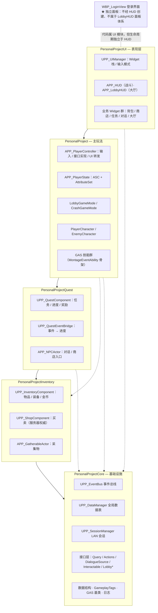
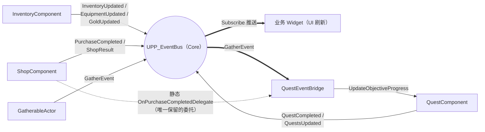
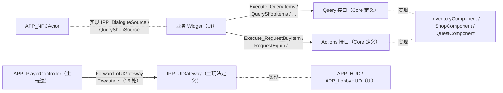
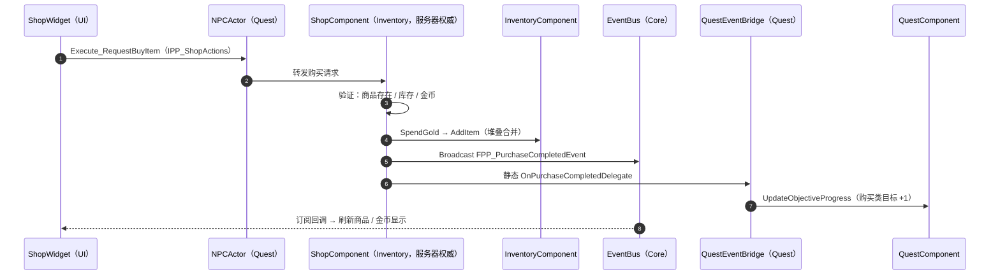
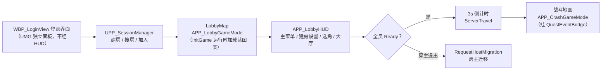

# PersonalProject 项目架构文档

> 状态：背景资料 · 最后更新：2026-10-16 · 取代关系：无（架构参考；其中 CoreRedirects/事件数量等数字已过时）
> 本文档面向需要深入理解本项目的开发者，涵盖模块划分、核心系统、通信规则与上手路线。
> 基于 Unreal Engine 5.7，最后更新：2026-10-16（五模块拆分完成后）。

---

## 1. 项目概览

这是一个**多人 LAN 联机 ARPG 框架**，C++ 为主、蓝图资产为内容层（UnLua 仅存早期测试 demo 残留，非正式功能）：

- **联机模型**：基于 OnlineSubsystem 的 LAN 会话，流程为「UMG 登录界面 → 大厅地图（建房/选角/聊天/准备）→ ServerTravel → 战斗地图」
- **战斗体系**：Gameplay Ability System（GAS），5 个玩家技能位、采集技能、敌人 AI 技能、伤害执行计算
- **业务系统**：背包/装备/金币、商店买卖、可采集物、任务（接取/进度/提交/奖励）、NPC 对话
- **UI 体系**：UIManager 统一 Widget 栈与输入模式，大厅 HUD 与战斗 HUD 分离
- **工程结构**：5 个 C++ 模块，单向无环依赖（2026-10-16 完成拆分）

---

## 2. 模块架构与依赖方向

```
PersonalProjectCore        基础设施：事件总线 / 数据表 / 接口 / 数据结构 / GAS 基类 / Tags
        ↑
PersonalProjectInventory   背包、装备、金币、商店、可采集物        （依赖 Core）
        ↑
PersonalProjectQuest       任务管理、任务事件桥、NPC/对话          （依赖 Core + Inventory）
        ↑
PersonalProject            主玩法：PC/PS/GameMode、GAS 技能、角色  （依赖 Core + Inventory + Quest）
        ↑
PersonalProjectUI          UIManager、HUD、全部 Widget、Lua 胶水   （依赖全部四个）
```

依赖**单向无环**，下层模块对上层零感知。声明见 [PersonalProject.uproject](../../PersonalProject.uproject)，各模块依赖见其 Build.cs。

### 2.1 模块构成与依赖总览



**跨层通信的三条通道**（这是理解全项目最关键的模型）：

| 方向 | 机制 | 示例 |
|---|---|---|
| 下层 → 上层（通知） | **事件总线**广播事件结构体 | 背包变化、购买完成、采集完成 |
| 上层 → 下层（查询/命令） | **Core 接口**（Query/Actions 读写分离） | UI 经 `IPP_InventoryQuery` 读背包 |
| 主玩法 → UI | **IPP_UIGateway** 单一网关接口 | PC 转发暂停菜单、推送聊天 |

### 2.2 通道一：事件流（下层 → 上层）



### 2.3 通道二/三：接口流（上层 → 下层）



### 2.4 模块间交互示例：购买链路端到端时序



---

## 3. Core 模块（PersonalProjectCore）

位置：`Source/PersonalProjectCore`。所有跨模块共享的类型、接口、基础设施都沉在这里。

### 3.1 事件总线 —— 解耦核心

[PP_EventBus.h](../../Source/PersonalProjectCore/Public/Events/PP_EventBus.h)：`UGameInstanceSubsystem`，类型安全泛型 API：

```cpp
Bus->Subscribe<FPP_GatherEvent>(this, &MyClass::OnGather);   // 订阅，返回句柄
Bus->Broadcast(FPP_GatherEvent{...});                        // 发布
Bus->Unsubscribe(Handle);                                    // 取消
```

- 以事件结构体的 `StaticStruct()` 做类型索引，编译期类型检查
- **订阅者负责在析构时 Unsubscribe**，否则野指针崩溃（注释中有明确警告）
- 快捷方式：`UPP_EventBus::BroadcastEvent(WorldContext, Event)`

[PP_EventTypes.h](../../Source/PersonalProjectCore/Public/Events/PP_EventTypes.h) 集中定义 8 个标准事件：
`FPP_QuestCompletedEvent`、`FPP_QuestsUpdatedEvent`、`FPP_InventoryUpdatedEvent`、`FPP_EquipmentUpdatedEvent`、`FPP_GoldUpdatedEvent`、`FPP_ShopResultEvent`、`FPP_PurchaseCompletedEvent`、`FPP_GatherEvent`。
**新增跨系统事件只需在此追加 USTRUCT。**

### 3.2 数据表统一管理

[PP_DataManager.h](../../Source/PersonalProjectCore/Public/Framework/PP_DataManager.h)：`UCLASS(Config=Game)` 的 GameInstanceSubsystem，集中持有三张**全局**数据表：

- `GetItemInfo / GetQuestInfo / GetCharacterData / GetCharacterRowNames / HasCharacterTable`
- 表路径在 `Config/DefaultGame.ini` 的 `[/Script/PersonalProjectCore.PP_DataManager]` 段配置
- 内部用 `FindRowFromTable<RowType>` 模板收敛查询

> 注意：**实例级**数据表（如商人的商品表）不由 DataManager 管，由组件自持。

### 3.3 会话管理

[PP_SessionManager.h](../../Source/PersonalProjectCore/Public/Session/PP_SessionManager.h)：LAN 会话封装——`CreateSession / FindSessions / JoinSession / DestroyCurrentSession`，同时统一持有角色选择数据（单一数据源）。

### 3.4 接口层（Core 定义的契约）

读写分离（Query 只读 / Actions 写命令）是固定模式，UI 只认识这些接口：

| 接口 | 方法 | 实现者 |
|---|---|---|
| `IPP_InventoryQuery` | QueryItems / QueryEquippedItems / QueryGold / QueryItemCount | InventoryComponent |
| `IPP_InventoryActions` | RequestEquip / RequestUnequip / RequestUseConsumable | InventoryComponent（内部转服务器 RPC） |
| `IPP_ShopQuery` | QueryShopItems / QueryBuyPrice / QuerySellRate | ShopComponent |
| `IPP_ShopActions` | RequestBuyItem / RequestSellItem | ShopComponent |
| `IPP_QuestQuery` | QueryActiveQuests / QueryCompletedQuests / QueryQuestInfo | QuestComponent |
| `IPP_DialogueSource` | QueryDialogueTable / QueryShopSource | NPCActor |
| `IPP_Interactable` | Interact / CanInteract（纯 C++ 虚函数） | NPC、采集物等可交互体 |
| `IPP_LobbyActions` | RequestSetReady / RequestStartGame / RequestSendChatMessage 等 | PlayerController |
| `IPP_LobbyPlayerInfo` / `IPP_GameFlowRequest` | 大厅信息查询 / 游戏流程请求 | LobbyPlayerState / GameMode |

> **铁律：接口的 `BlueprintNativeEvent` 方法禁止经接口指针直接调用**（UHT 桩里 `check(0)`），必须用 `IXxx::Execute_Method(Object, ...)` 静态分发，且调用前用 `Cast<IXxx>` 做非空/实现守卫。

### 3.5 其他基础设施

- **数据结构**：`Data/` 下的 `FPP_ItemInfo`（物品行：类型/图标/堆叠/价格/GE 效果/装备槽/稀有度）、`EPP_ItemType/EPP_EquipSlot/EPP_ItemRarity`、任务/商店/对话/角色数据行
- **GAS 基类**：[PP_AttributeSet.h](../../Source/PersonalProjectCore/Public/AbilitySystem/PP_AttributeSet.h)（Health/Mana/Attack/Defense）、`UPP_AbilitySystemComponent`、[PP_BaseCharacter.h](../../Source/PersonalProjectCore/Public/Characters/PP_BaseCharacter.h)（全角色共同祖先）
- **GameplayTags**：[PPTags.h](../../Source/PersonalProjectCore/Public/GameplayTags/PPTags.h) native tag 声明（`PPAbilities.* / Events.* / Status.* / State.*` 等），**必须带 `PERSONALPROJECTCORE_API` 导出宏**才能跨 DLL 共享
- **日志**：[PP_Log.h](../../Source/PersonalProjectCore/Public/Framework/PP_Log.h) 统一 `UE_LOG(LogPP, ...)`；流程追踪日志已降级 Verbose，Warning 只留给真异常
- `UPP_LocalSaveGame`（本地存档）、`UPP_ItemUILibrary`（物品 UI 工具函数）、`APP_CharacterPreviewActor`（选角预览）

---

## 4. 主玩法模块（PersonalProject）

位置：`Source/PersonalProject`。

### 4.1 玩家链路

- [PP_PlayerController.h](../../Source/PersonalProject/Public/Player/PP_PlayerController.h)：输入（EnhancedInput：移动/视角/5 技能/UI 热键）、技能激活（`TryActivateAbilitiesByTag`）、实现 `IPP_LobbyActions` 与 `IPP_DialogueRequester`、交互检测（对命中 Actor `Cast<IPP_Interactable>` 单一判断，无 Cast 链）
- **UI 转发**：`ForwardToUIGateway(&IPP_UIGateway::Execute_Xxx, args...)` 泛型模板把 16 处 UI 调用收敛为一行/处，经 [PP_UIGateway.h](../../Source/PersonalProject/Public/Player/PP_UIGateway.h) 到达 HUD
- `APP_PlayerState`（GAS 属性持有）、`APP_LobbyPlayerState`（大厅准备/选角状态）

### 4.2 GameMode 与流程

- [PP_LobbyGameMode.cpp](../../Source/PersonalProject/Private/Game/PP_LobbyGameMode.cpp)：
  - **构造函数只设 C++ 兜底类**；蓝图类（BP_PP_PlayerController 等）改在 `InitGame` 运行时 `LoadClass<T>()` 加载——原生 CDO 在主玩法模块加载期构造，同步加载引用 UI 模块类的蓝图会炸（详见 §9 踩坑记录）
  - HUDClass 兜底需同时判 `nullptr` 和 `AHUD::StaticClass()`（AGameModeBase 默认赋了 AHUD）
  - 全员准备 → 3 秒倒计时 → `ServerTravel` 到战斗地图
- `APP_CrashGameMode`（战斗地图 GM，挂载 `UPP_QuestEventBridge`）、`UPP_GameInstance`

大厅到战斗的完整流程：



### 4.3 GAS 技能体系

> 本节的完整深入版见专题文档 [GAS技能系统.md](../参考/GAS技能系统.md)（技能骨架、伤害双路径、Tag 全清单、扩展指南）。

```
UPP_GameplayAbility（项目技能基类）
  └── UPP_MontageEventAbility（Abstract，收敛共用骨架）
  │     └── PP_Primary / Secondary / Tertiary（玩家近战三连，Primary 内部 FlipFlop）
  ├── PP_GatherAbility（采集：InstancedPerActor + ServerOnly，State.Gathering Tag 互斥）
  ├── PP_Death、敌人 PP_SearchForTarget / PP_HitReact
```

- **MontageEventAbility 骨架**（理解玩家技能只需读它）：上 BlockHitReact GE → 缓存参数 → 播蒙太奇（4 绑定）→ `WaitGameplayEvent` → 事件触发 `OnAbilityEventReceived` → EndAbility 移除 GE。子类只提供 `GetMontageToPlay / GetEventTagToWait / OnAbilityEventReceived` 三个差异点
- AbilityTasks：[PP_WaitGameplayEvent.h](../../Source/PersonalProject/Public/AbilitySystem/AbilityTasks/PP_WaitGameplayEvent.h)、`UPP_AttributeChangeTask`（属性变化监听）
- `UPP_DamageExecutionCalculation`：伤害执行计算（攻击/防御公式）
- [PP_BlueprintLibrary.cpp](../../Source/PersonalProject/Private/Utils/PP_BlueprintLibrary.cpp) 的 `SendDamageEventToPlayer`：按伤害结果发 `Death/HitReact` GameplayEvent，攻击者写入 GEContext（供击杀任务溯源）

### 4.4 其他

- `APP_Projectile / APP_FireballProjectile`（投掷物）、`UPP_MeleeAttack`（AnimNotify 近战判定）
- `APP_PlayerCharacter / APP_EnemyCharacter` 继承 Core 的 `APP_BaseCharacter`
- 私有依赖 AIModule（敌人搜索目标）

---

## 5. Inventory 模块（PersonalProjectInventory）

- [PP_InventoryComponent.h](../../Source/PersonalProjectInventory/Public/Inventory/PP_InventoryComponent.h)：挂在 PlayerState/Character 上，管物品槽、装备槽、金币。`AddItem` 先合并同 ID 堆叠再开新槽；每次变更广播对应事件。**实现 Query+Actions 双接口，UI 不认识这个具体类**
- [PP_ShopComponent.h](../../Source/PersonalProjectInventory/Public/Shop/PP_ShopComponent.h)：挂在 NPC 上，实例级 `ShopDataTable` 自持。购买流程**服务器权威**：验证商品/库存/金币 → `SpendGold` + `AddItem` → 广播 `FPP_PurchaseCompletedEvent`，同时触发**静态** `OnPurchaseCompletedDelegate`（任务系统的监听入口，全项目唯一保留的委托）
- [PP_GatherableActor.h](../../Source/PersonalProjectInventory/Public/Gather/PP_GatherableActor.h)：可采集物，实现 `IPP_Interactable`，支持多次采集、耗尽重生、多人互斥，完成时广播 `FPP_GatherEvent`

## 6. Quest 模块（PersonalProjectQuest）

- [PP_QuestComponent.h](../../Source/PersonalProjectQuest/Public/Quest/PP_QuestComponent.h)：活跃/已完成任务、目标进度、提交验证、奖励发放、组队共享进度；实现 `IPP_QuestQuery`
- **奖励发放是刻意的直接调用**（`InventoryComponent::AddGold/AddItem`）——提交验证与发奖是强因果时序，属事件总线的设计豁免，发完后才广播 `FPP_QuestCompletedEvent`
- [PP_QuestEventBridge.h](../../Source/PersonalProjectQuest/Public/Quest/PP_QuestEventBridge.h)：**事件→任务进度的翻译器**，挂在战斗 GameMode 上；订阅 EventBus 的 `FPP_GatherEvent` + 绑定商店静态购买委托 → `UpdateObjectiveProgress`
- [PP_NPCActor.h](../../Source/PersonalProjectQuest/Public/Dialogue/PP_NPCActor.h)：实现 `IPP_Interactable` + `IPP_DialogueSource`，可选挂 ShopComponent；`GetShopSource()` 返回 `UObject*` 供接口化访问（旧 `GetShopComponent()` 保留避免蓝图断链）

## 7. UI 模块（PersonalProjectUI）

### 7.1 框架层

- [PP_UIManager.h](../../Source/PersonalProjectUI/Public/Framework/PP_UIManager.h)：GameInstanceSubsystem，**Widget 层级栈 + 输入模式统一管理**。Push/Pop 时触发生命周期通知并重算输入模式（游戏/游戏+UI/纯 UI）
- [PP_UIUserWidget.h](../../Source/PersonalProjectUI/Public/Framework/PP_UIUserWidget.h)：所有独立屏幕面板的基类，蓝图子类设 `OwningLayer` 决定层级；`NativeConstruct` 自动注册进 UIManager。**具体类的 BlueprintNativeEvent（OnWidgetPushed 等）可直接调用**——只有接口的才必须 Execute_
- `UPP_UICrossModule`：PC 的约 20 个 UI 相关 `_Implementation` 胶水集中在此（属 UI 模块），是解耦的固定成本
- `UPP_UIViewModel / UPP_WidgetPool / UPP_WidgetComponent / UPP_UIStyle`

### 7.2 HUD 双轨

- `APP_LobbyHUD`（大厅）：`CreatePanelWidget<T>(bStartHidden)` / `ShowPanel<T>` 模板助手创建/切换 MainMenu、HostSettings、Settings、RoomSettings、CharacterSelect、Lobby 六个面板；`GetFromWidget()` 静态供任意 Lobby Widget 取回 HUD
- `APP_HUD`（战斗）：`GetOrCreateWidget / PopAndClearWidget` 助手管理 HUDWidget、暂停菜单、死亡屏、计分板等
- 两个 HUD 都实现 `IPP_UIGateway`，是主玩法调用 UI 的唯一落点

### 7.3 业务 Widget 的统一姿势

背包/装备/商店/任务/对话全部 Widget 遵循同一模式：**Core 接口查询数据（Execute_ 分发）+ 订阅事件总线刷新**。例如 ItemSlot/EquipSlot 共用 [PP_SlotWidgetBase.h](../../Source/PersonalProjectUI/Public/Inventory/PP_SlotWidgetBase.h) 基类（Tooltip 0.3s 延迟/跟随/销毁生命周期），子类只实现 `CanShowTooltip / FillTooltipData`。

### 7.4 登录界面与 UnLua 残留

- 登录界面是 **UMG 独立面板，不是任何 HUD 的子面板**：WBP_LoginView，C++ 基类 [PP_LoginViewWidget.h](../../Source/PersonalProjectUI/Public/Lobby/PP_LoginViewWidget.h)（继承 `UPP_UIUserWidget`）。它**不属于** `APP_LobbyHUD::CreateWidgets` 创建的六面板体系（MainMenu / HostSettings / Settings / RoomSettings / CharacterSelect / Lobby），也不经 `ShowPanel` 切换管理——创建与显示完全独立，因此 LobbyHUD 未生成时（如 HUDClass 未配置的场景）登录界面照样显示
- `Content/Script/` 下的 Lua（Practice 练习、LuaFrameWork、旧登录菜单）是**早期测试 demo 残留**，非正式功能
- [PP_MenuData.cpp](../../Source/PersonalProjectUI/Private/Lobby/PP_MenuData.cpp) 是当年 Lua 登录菜单的绑定胶水残留（导出 FLoginMenuItemRow 到 UnLua，UI Build.cs 因此私有依赖 UnLua/Lua）；登录菜单资产曾因以 Lua 字符串路径加载导致打包丢失，已改为 Widget 上的 C++ 硬引用（`LoginMenuTable` / `MenuItemClass`），烘焙器沿 CDO 引用图打包

---

## 8. 数据驱动与配置

| 配置 | 内容 |
|---|---|
| `Config/DefaultGame.ini` | DataManager 三张全局表路径（段名 `[/Script/PersonalProjectCore.PP_DataManager]`，**段名必须跟随类所在模块**） |
| `Config/DefaultEngine.ini` | 79 条 CoreRedirects（模块拆分后的类/结构体重定向）、地图、GameMode 默认类 |
| `Config/DefaultGameplayTags.ini` / `DefaultInput.ini` / `DefaultUnLuaSettings.ini` | Tag、输入映射、Lua |
| 数据表资产 | `Content/PersonalProject/Data/` 下的物品/任务/角色表，行结构对应 Core 的 Data 结构体 |

**改玩法数据的常规路径**：改数据表行（Content）→ 必要时改 Core 的行结构体（C++）→ UI/组件自动经 DataManager/接口拿到，无需动逻辑代码。

---

## 9. 关键设计决策与踩坑记录

这些是项目演进中用真实 bug 换来的规则，修改代码前务必了解：

1. **接口 BlueprintNativeEvent 必须 Execute_ 调用**——直接调命中 `check(0)` 桩崩溃。项目仅 3 个接口含事件方法：`IPP_UIGateway`（PC 16 处）、`IPP_DialogueRequester`（NPC 2 处）、对话相关；`IPP_Interactable` 是纯虚函数可直接调
2. **原生构造函数禁止同步加载引用后加载模块类的蓝图**（ConstructorHelpers/StaticLoadClass）——CDO 构造早于后加载模块注册，会级联出资产父类加载失败；蓝图类一律 `InitGame` 运行时 `LoadClass<T>()`
3. **CoreRedirects 反射路径名剥离前缀**：类剥 U/A、结构体剥 F、枚举保留 E。迁移类后必须按新模块目录全量比对补齐，组件类最容易漏
4. **Config 段名跟随类所在模块**：Config 类跨模块迁移后必须同步改 ini 段名，CoreRedirects 不管 ini 匹配
5. **UCLASS(Abstract) 不能含纯虚函数**（GENERATED_BODY 展开会实例化，C2259）——一律「默认实现+要求子类 override」
6. **C++ 零引用 ≠ 资产零引用**：删类前先 Glob Content 搜同名资产（`PP_Fifth` 空壳因 GA 资产引用而保留）
7. **HUDClass 兜底要判 `AHUD::StaticClass()`**，不能仅判 nullptr
8. Content/ 与 Config/ 曾长期被 .gitignore 忽略（已修复并配 LFS）；在重定向修复生效前**绝不保存蓝图**，否则空引用固化进 uasset 无法回滚
9. 跨模块共享 native GameplayTag 声明必须带模块 API 导出宏

---

## 10. 上手路线图

推荐阅读顺序（每步都可跳读对应章节）：

1. **建立全局观**：本文 §2 依赖图 + §3.4 接口表 → 读 [PP_EventTypes.h](../../Source/PersonalProjectCore/Public/Events/PP_EventTypes.h)（8 个事件即 8 条系统间消息）
2. **理解玩家侧**：[PP_PlayerController.h](../../Source/PersonalProject/Public/Player/PP_PlayerController.h) → `SetupInputComponent`（输入全集）→ `ForwardToUIGateway`（UI 调用方式）
3. **理解战斗**：`UPP_MontageEventAbility` 骨架 → 一个具体技能（如 PP_Primary）→ `SendDamageEventToPlayer` 伤害闭环
4. **理解业务闭环**：挑一条链路端到端跟一遍，推荐「购买」：ShopWidget（UI）→ `IPP_ShopActions::Execute_RequestBuyItem` → ShopComponent（服务器验证）→ 事件总线广播 → QuestEventBridge 推进任务 + UI 刷新
5. **理解 UI 框架**：[PP_UIManager.cpp](../../Source/PersonalProjectUI/Private/Framework/PP_UIManager.cpp) Push/Pop → `UPP_UIUserWidget::NativeConstruct` 自注册 → `APP_LobbyHUD::ShowPanel` 面板切换
6. **理解大厅流程**：登录界面（UMG）→ SessionManager 建房 → LobbyGameMode（准备/选角/聊天）→ ServerTravel

---

## 11. 目录速览

```
Source/
  PersonalProjectCore/       Framework(事件总线/数据/会话/日志) · Data(行结构) · AbilitySystem(GAS基类)
                             Characters · GameplayTags · Interaction · 各业务接口
  PersonalProjectInventory/  Inventory · Shop · Gather
  PersonalProjectQuest/      Quest · Dialogue(NPC)
  PersonalProject/           Player · Game · Characters · AbilitySystem(技能/Tasks/Executions)
                             Interaction · GameObjects · Notifies · Utils
  PersonalProjectUI/         Framework(UIManager/基类/VM/池/胶水) · Lobby · HUD
                             Inventory · Shop · Quest · Dialogue · Interaction · Widgets
Content/
  PersonalProject/           自有资产（AbilitySystem/Characters/Data/Game/Maps/Player/UI/Input...）
  Script/                    UnLua 早期测试 demo 残留（Practice 练习、LuaFrameWork、旧登录菜单绑定）
  其余目录                    第三方资源包（Paragon 角色、特效、UI 包等）
Config/                      DefaultEngine.ini(CoreRedirects) · DefaultGame.ini(数据表) · ...
Docs/                        本文档、LobbyUI Mockup、设计稿
```
